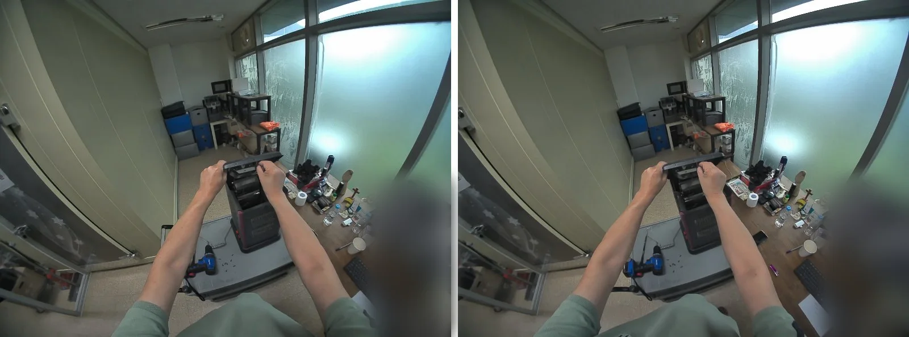
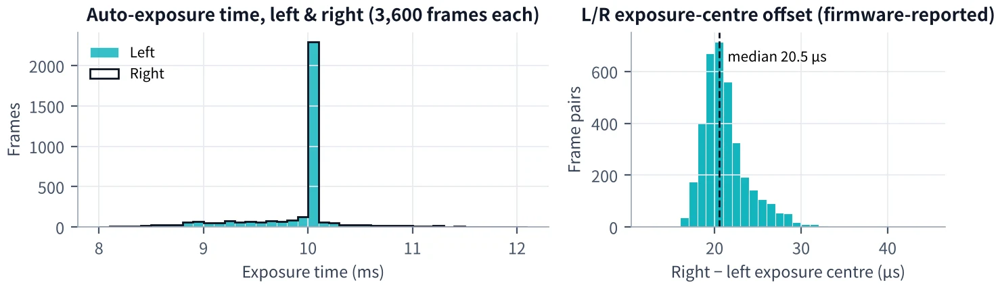
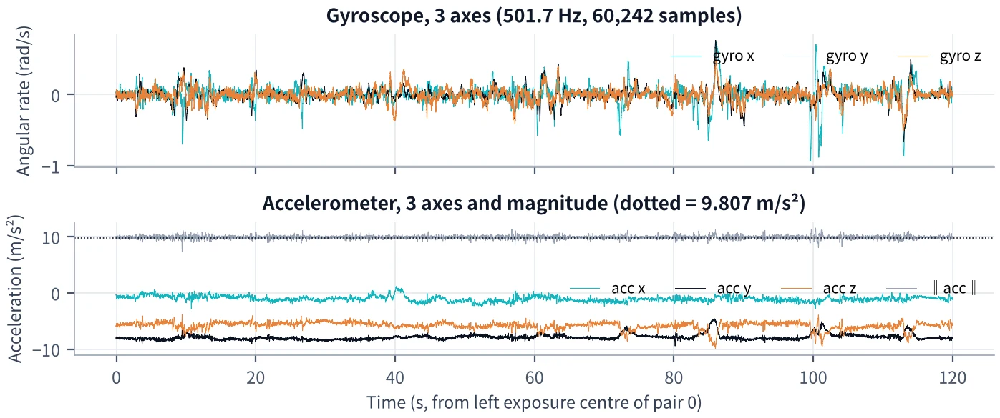
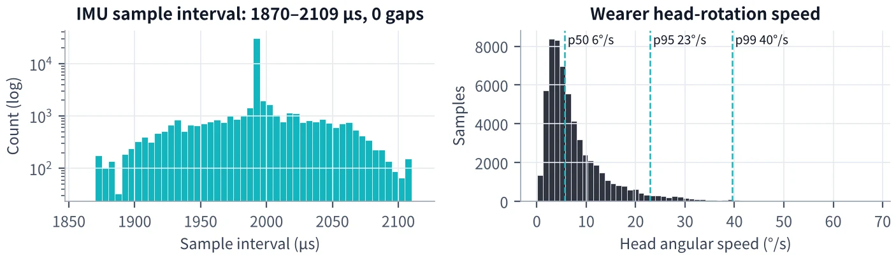
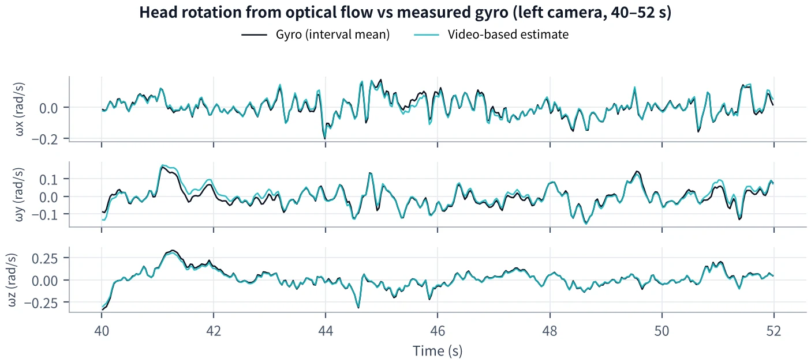
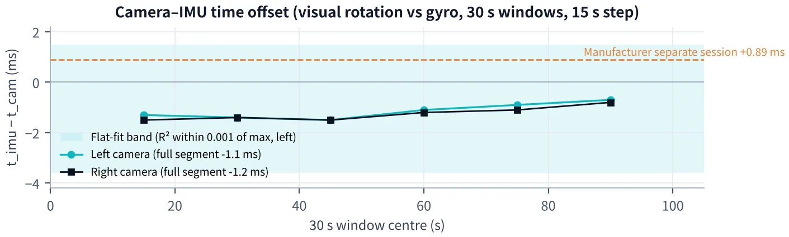
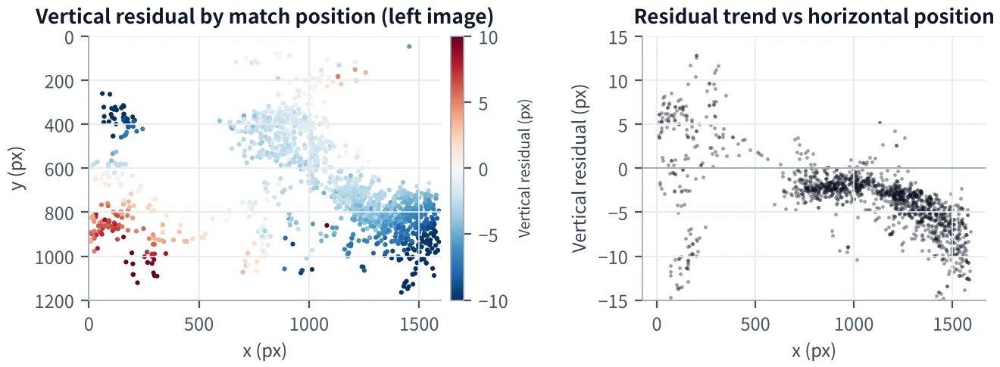
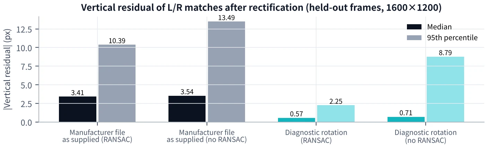
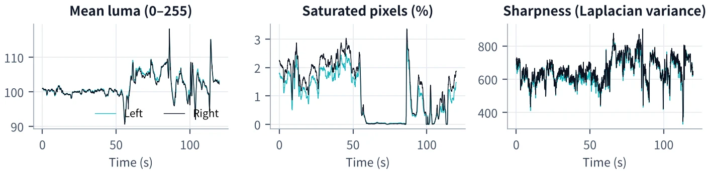

# Stereo + IMU Egocentric Capture
### Technical Evaluation · Field Note #03

**Origin Data Lab** · October 2026 · Physical AI / Robotics / Multimodal Data

[**English Field Note ↗**](https://origindatalab.io/technical-field-notes/stereo-imu-egocentric-sample.html) · [**한국어 기술노트 ↗**](https://origindatalab.io/ko/technical-field-notes/stereo-imu-egocentric-sample.html) · [Technical report](TECHNICAL_REPORT.md) · [Validation status](VALIDATION_STATUS.md)

> **Evaluation evidence, not a production calibration certificate.** This repository summarizes a 120-second head-mounted stereo and 6-axis IMU recording. Raw video, raw IMU, device calibration binaries and executable validation scripts are not published here.

## Capture at a glance

| Stereo capture | IMU stream | Frame correspondence | Exposure-center difference |
|:---:|:---:|:---:|:---:|
| **1600 × 1200 · 30 fps** | **≈ 501.7 Hz** | **3,600 / 3,600 pairs** | **20.5 µs median** |
| 120 seconds, each camera | Evaluated recording | Frame ticks matched | Device-reported; not externally verified |

*Figure 1 — Corresponding stereo frame pair (frame 1,500). Monitor content is blurred in the public illustration.*

## 01 · Stereo frame timing

Both streams showed matching frame ticks for all 3,600 pairs, without missing frame-counter increments. Global visual-motion correlation peaked at zero-frame lag (**r = 0.997**). The reported left–right exposure-center difference is derived from device metadata; an independent optical timing test remains outstanding.

*Figure 2 — Exposure timing and left–right exposure-center differences. Device-recorded timing is not an independent microsecond-accuracy certification.*

## 02 · IMU continuity and motion

The evaluated 6-axis IMU stream averaged approximately **501.7 Hz**. No duplicates, missing intervals or saturation were observed in the inspected range. This result is specific to the evaluated recording.

*Figure 3 — Raw 3-axis gyroscope and accelerometer signals.*

*Figure 4 — IMU sampling intervals and head angular-rate diagnostics.*

## 03 · Camera–IMU temporal alignment

Image motion and gyroscope signals were compared to **estimate**, not certify, camera–IMU offsets. The best-fit values were **−1.1 ms (left)** and **−1.2 ms (right)**, with fitting scores of **R² = 0.973 / 0.974**. The 30-second window estimates varied by up to 0.8 ms. A manufacturer result from another sensor mode differs; that discrepancy remains unresolved.

*Figure 5 — Image-derived rotation compared with gyroscope motion.*

*Figure 6 — Estimated offsets across analysis windows; not production synchronization constants.*

## 04 · Stereo calibration limitations

The supplied calibration file appears to refer to a **1920 × 1080** imaging mode, whereas this recording was captured at **1600 × 1200**. Applying it directly yielded position-dependent vertical rectification residuals. A diagnostic 3-DOF adjustment reduced median holdout vertical residual to **0.570 px** but changed horizontal disparity, so it **must not** be treated as validated production rectification.

*Figure 7 — Spatially structured vertical residuals under supplied calibration parameters.*

*Figure 8 — Diagnostic correction residuals; improved vertical residual alone does not validate stereo geometry.*

## 05 · Image-quality diagnostics

*Figure 9 — Per-frame image-quality diagnostics from the evaluated sample.*

## Evidence classification

| Observation | Result | Interpretation |
|---|---|---|
| Video decoding and frame counts | 3,600 frames per camera | **Verified** in evaluated record |
| Stereo frame tick correspondence | 3,600/3,600 matched | **Verified** from recorded SEI |
| Frame counter continuity | No missing increments | **Verified** in evaluated record |
| Visual frame-motion correspondence | Peak at 0-frame lag, r = 0.997 | **Evaluated** |
| Exposure-center simultaneity | Median 20.5 µs | **Device-reported**; external optical verification pending |
| IMU continuity | ≈501.7 Hz; no observed gaps/duplicates/saturation | **Verified** in evaluated record |
| Camera–IMU offset | −1.1 ms / −1.2 ms | **Estimated**, not certified |
| Stereo calibration for capture mode | Supplied parameters mismatch mode | **Not production-validated** |
| Camera–IMU extrinsics | No validated parameters for this mode | **Not production-validated** |

**Scope boundary:** No independent microsecond synchronization certification, final camera–IMU extrinsic calibration, validated production stereo rectification, or claim of downstream robot-learning improvement is provided.

## Documentation and access

- [**Technical report**](TECHNICAL_REPORT.md) — measurement approach, detailed results and interpretation
- [**Validation status**](VALIDATION_STATUS.md) — verified, device-reported, estimated and pending items
- [**All nine figures**](figures/) — the published technical illustrations
- [**English Field Note #03**](https://origindatalab.io/technical-field-notes/stereo-imu-egocentric-sample.html) · [**한국어 Field Note #03**](https://origindatalab.io/ko/technical-field-notes/stereo-imu-egocentric-sample.html)

For evaluation-package availability or project-specific real-world data production, contact **contact@origindatalab.io** · [origindatalab.io](https://origindatalab.io).

© 2026 Origin Data Lab. No reuse license is granted by default; contact us for permissions.
aw IMU files, calibration binaries, device-specific firmware, or independently executable validation scripts. Those should not be inferred from this repository.

## Contact

For evaluation-package availability and project-specific collection: **contact@origindatalab.io** · https://origindatalab.io

© 2026 Origin Data Lab. No license is granted by default for repository content; contact us for reuse permissions.
